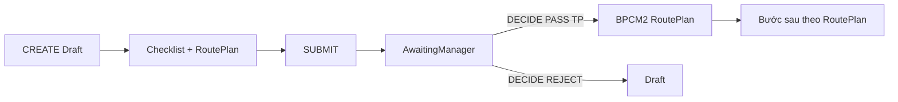

# EMI PAY — Rà soát mô hình dữ liệu (seed + BA mới)

> Cập nhật 12/11/2026. **FK Text giữ nguyên**. CFG qua Site Contents + seed.  
> **BA đã đổi:** duyệt nội bộ BPCM1 (`AwaitingManager`) + **RoutePlan** pin lúc tạo/trình.

## 1. Luồng nghiệp vụ (tóm tắt)



## 2. Tầng cấu hình (seed)

Nguồn: `9.EMI_PAY_Core_Orchestrator_V1/config/seed-config.json`.

| List | Seed |
|---|---|
| **OrgUnits** | 5 phòng + `OU_CHAIR` (`ManagerUPN=TO_FILL`) |
| **OrgMembers** | Không seed — Site Contents |
| **PaymentTypes** | `SPV_PAYMENT` → `EMI_PAY_SPV` |
| **WorkflowVersions / Steps** | `EMI_PAY_SPV` v1 · 7 StepKey Core |
| **StepRecipients** | Danh sách OU **được phép** pin vào RoutePlan |
| **ChecklistTemplates** | DOC_REQUEST / INVOICE / CONTRACT |

## 3. Requests — field vận hành mới

| Field | Ý nghĩa |
|---|---|
| `RoutePlanJson` | JSON `StepKey → OUCode` (pin lúc tạo/trình) |
| `Status=AwaitingManager` | Đã trình TP phòng tạo; chưa sang BPCM2 |

Ví dụ RoutePlan:

```json
{"BPCM2_TECH":"OU_KINHTE","BPCM3_PRICE":"OU_TONGHOP","TCKT_CHECK":"OU_TCKT","CHAIR_APPROVE":"OU_CHAIR","TCKT_PAY":"OU_TCKT","SYSTEM_ARCHIVE":"OU_TCKT"}
```

## 4. StepRecipients (seed — lựa chọn khi pin)

| StepKey | OU |
|---|---|
| `BPCM1_PREPARE` | 5 phòng đều được tạo (`CreatedOUCode` từ payload) |
| `BPCM2_TECH` | `OU_KYTHUAT` (default), `OU_KINHTE` |
| `BPCM3_PRICE` | `OU_KINHTE` (default), `OU_TONGHOP` |
| `TCKT_*` / `SYSTEM_ARCHIVE` | `OU_TCKT` |
| `CHAIR_APPROVE` | `OU_CHAIR` |

Flow: `SUBMIT` → AwaitingManager; TP `DECIDE` PASS → BPCM2; mọi bước sau lấy OU từ **RoutePlanJson** (không hardcode).

## 5. Seed / schema CECM

```powershell
cd F:\Projects\sharepoint\emi-workflow\9.EMI_PAY_Core_Orchestrator_V1
.\04_Add_Request_RoutePlan_AwaitingManager.ps1 -Mode Apply
.\02_Add_OrgMembers_MemberRole.ps1 -Mode Apply
.\03_Enforce_Cfg_UniqueKeys.ps1 -Mode Apply
.\01_Seed_Config.ps1 -Mode Apply
```

Sau seed: điền `ManagerUPN` + OrgMembers trên Site Contents.
